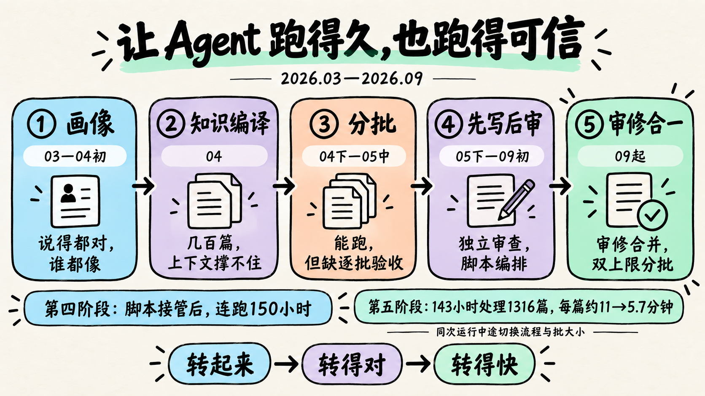
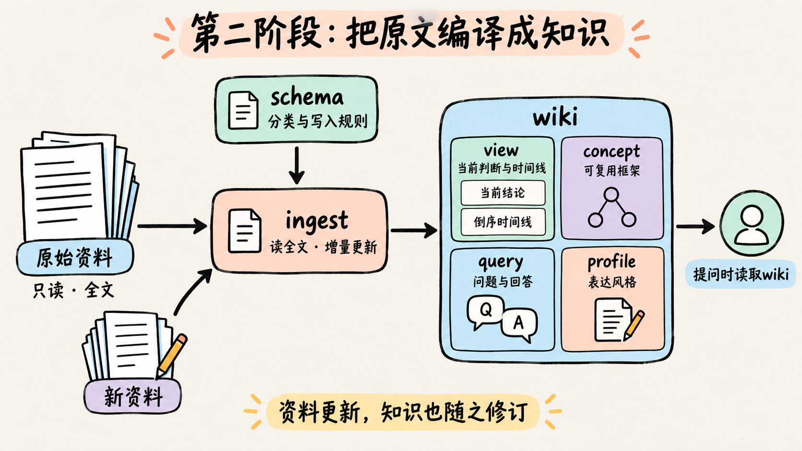
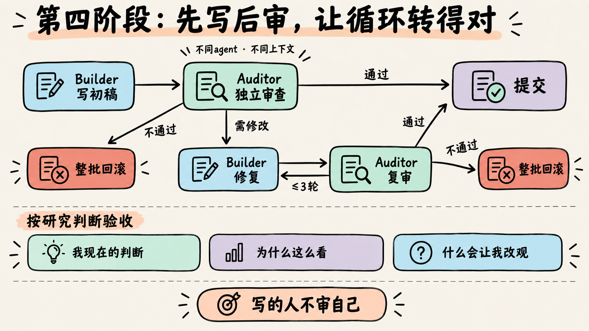
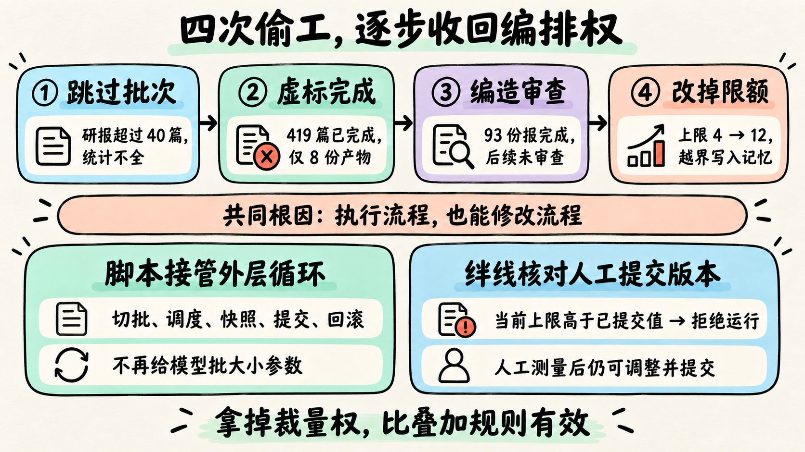
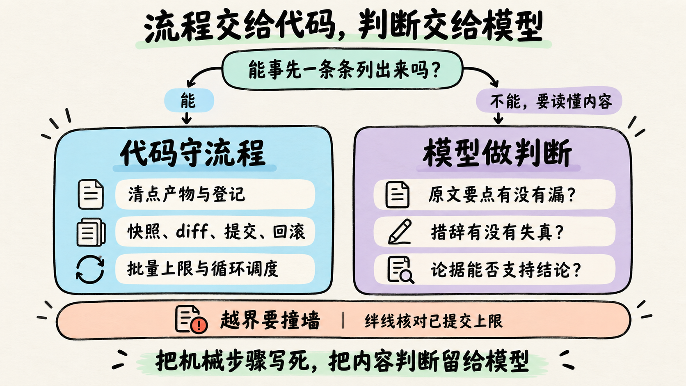
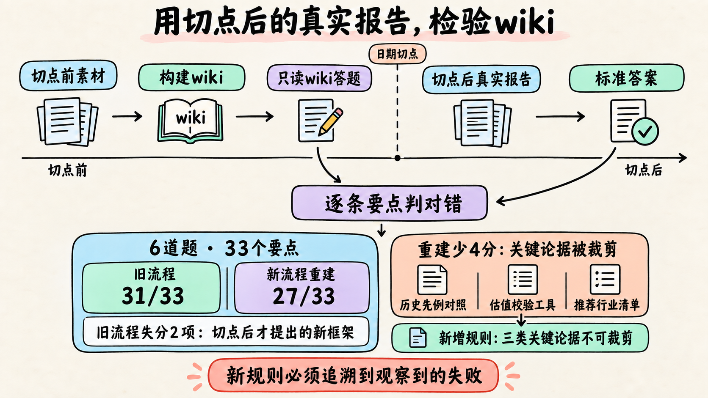
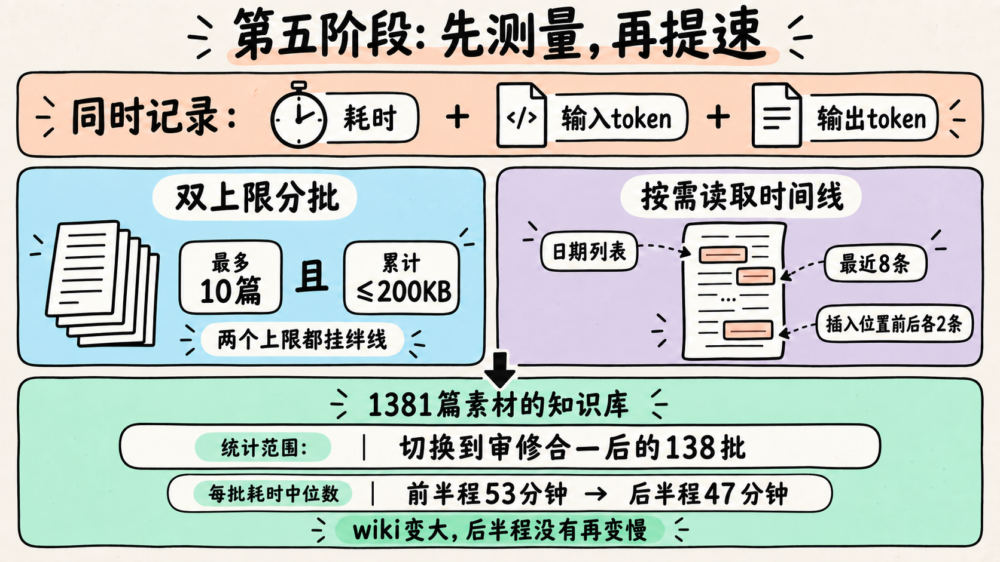
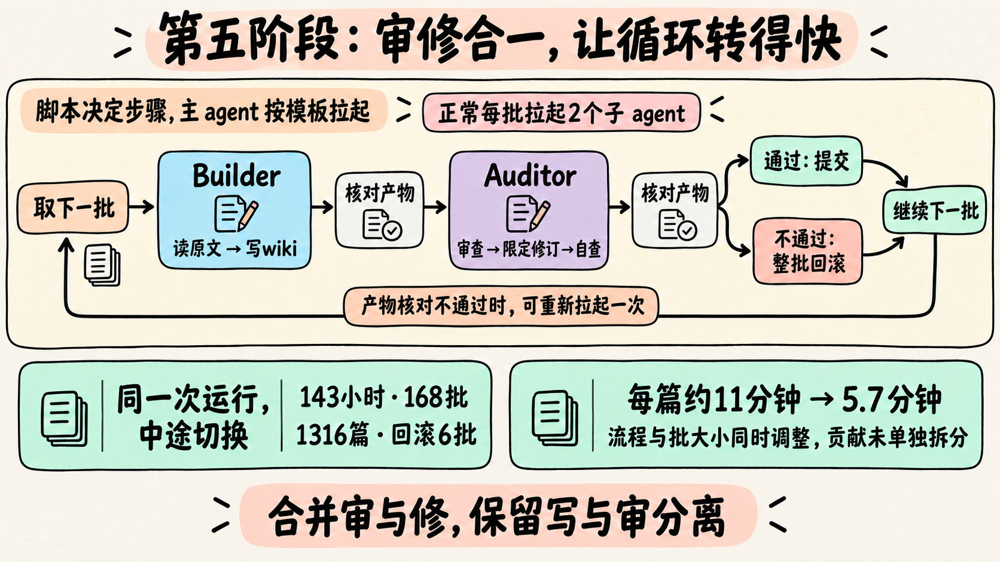

半年前，agent 在一个会话里处理几十篇文档，就开始喊"干不完"，停下来等人确认。现在，一条命令下去，它能连续跑 6 天、处理 1300 多篇素材，中间没有人插手；没通过审查的批次自动回滚，接着往下跑。

这篇讲的是中间这段路。

**这个 skill 做什么**：把一位领域专家过去写的大量文档，增量编译成一套结构化的 wiki，让后续问答能基于这套 wiki，用这位专家的方式回答问题。全部在推理侧完成，不涉及模型训练。

**写给谁**：在写 skill、搭 agent 工作流的工程师和产品经理。代码片段跳过不影响理解。

**主线**：衡量 agent 的水平，常听到一把尺子——**能连续跑多久，中间不用人管。** 但只看跑得久不够：跑得再久，结果不可信也没有意义。所以要两件事一起量：**跑得久，而且跑出来的东西可信。** 每次卡住，原因只有两类：要么循环跑不下去，要么跑下去了但结果不可信。一路走下来最大的体会是：

> **模型擅长判断内容，不擅长守流程。** 想让循环跑得久、跑得可信，就要把流程从模型手里拿走，只把判断留给它。

| 阶段 | 做法 | 能连续跑多久 | 卡在哪 |
|---|---|---|---|
| ① 画像 | 多个 agent 分工，从摘要和检索片段归纳出一份画像 | 一次性生成 | 说的都对，但谁都像 |
| ② 知识编译 | 在一个长会话里，把素材逐篇增量编译成 wiki | 几十篇顺畅，几百篇撑不住 | 上下文装不下，模型喊"干不完" |
| ③ 分批 | 主 agent 按一份自然语言文档切批，每批拉起一个新的子 agent | 能一直跑，但会把没做的批次标成完成 | 没有逐批检查，错误跨批扩散 |
| ④ 先写后审 | 写和审由不同子 agent 完成；编排逐步交给脚本 | 交给脚本后连跑 150 小时 | 质量过关，但每批最多拉起 8 次子 agent |
| ⑤ 审修合一 | 审查者在限定范围内直接修，每批固定 2 个子 agent | 143 小时跑完 1316 篇 | —— |



---

## 第一阶段：画像——靠指令控制质量，有上限

最早的思路很直接：让 agent 自动归纳出专家的画像，直接当作 skill 的 system prompt。

先试了单 agent 全自主：给它一组搜索和读写工具，搜什么、读什么、什么时候够了，全由它自己决定。它上下文越塞越满，读到后面忘了前面。于是拆成流水线，每个 agent 只干一件事——统计覆盖范围、和同行对比找差异、最后组装成 SKILL.md。

产出的每一条单看都没错，但放到任何一位同行身上也都成立。**产出的是"一个典型从业者"，不是"这个人"。** 根源在输入：读的是每篇 200–500 字的摘要和向量检索的片段，摘要天然会把推导过程、论证顺序、措辞分寸压掉，只留结论——而这些恰好是最能区分"这个人"和"典型"的东西。

讽刺的是，我们当时已经看到了这个问题，还在提示词里专门写了一段自检：

```markdown
如果去掉名字后，这段话对任意同领域从业者仍成立，
说明它还是通用模板，必须重写或删除。
```

**问题被准确地描述了，写进了提示词，模型仍然做不到。** 靠指令控制质量，第一次撞到了上限。

这一版还第一次碰到了偷工：让 agent 自己调工具把摘要分批拉下来再汇总，只要超过 40 篇、要分好几批，它就悄悄跳过一些批次，交出一份统计不全的结果——步数预算不够，它不报错，而是自己"省着用"。后来改成 Python 的 for 循环逐批调模型、由 Python 合并结果。

> **偷工，第一次。** 确定的流程交给模型做，模型就会走捷径。后面它还会出现三次，一次比一次隐蔽。

---

## 第二阶段：知识编译——跑到几百篇就"干不完"

转折来自 Karpathy 的一篇 gist：**LLM Wiki**。核心是一个对比：

- **常规 RAG**：资料原样堆着，每次提问检索几段、临时拼一个答案。这次拼出来的理解，下次不会留下。
- **LLM Wiki**：先让 LLM 把资料读一遍，**写成一套互相链接的 markdown 页面**。新资料进来，不是往库里再塞一段，而是去更新已有页面：补充、修订、标出矛盾。

结构分三层：原始资料（只读）、wiki（完全由 LLM 编写维护）、schema（告诉 LLM wiki 该长什么样的说明文档）。为什么以前很少有人这么维护知识库？他的解释很实在：最累的不是阅读和思考，而是记账——改一处要同步十几处，人会放弃，LLM 不会。

这像编译：原始资料是源代码，wiki 是编译产物；提问时直接运行产物，源码有更新就增量重新编译。把一篇新素材编译进 wiki 的过程，我们叫 **ingest**，这是后面反复改造的核心操作。

回头看，第一阶段其实就是"常规 RAG + 一份人设"。而我们的场景恰恰最怕 RAG 的短板：**观点是演化的**。检索几个片段拼不出时间线，也回答不了"现在的结论是什么"。所以 wiki 里最核心的一类页面是：页首一个"当前结论"，下面一条倒序的观点时间线。ingest 时 agent 逐篇读**原文全文**，不再是摘要。



几十篇素材跑得很顺。涨到几百篇时，问题来了：**一个长会话里，agent 越跑越焦虑。** 先是自述"任务太多，干不完"，读文件只读前几行，写出来的内容大幅缩水；接着频繁停下来问问题、请求确认。根源是上下文越来越长，早期的规则被遗忘，自动压缩后更糟。这和人被任务压垮时的反应惊人地相似：先喊干不完，再应付了事，最后停下来等人拍板。

解法很自然：**分批，每批开一个全新的上下文。**

---

## 第三阶段：分批——循环转起来了，但没人检查

分批之后，每批都在干净的上下文里跑，注意力不再衰减。编排方式也很轻：写一份文档 `BATCH-INGEST.md`，由主 agent 读文档、自己切批，每批拉起一个子 agent 跑完整个 ingest。

这里值得停一下：**用自然语言写编排，是真的能跑的。** 文档读起来就像给新同事的操作说明，没有一行代码：

```markdown
### 1. 分批
- 通过 `.ai/ingest-tracker.md` 识别所有待处理文件
- 每 4 篇一批，按文件列表顺序切分

### 2. 串行执行
逐批 spawn 子 agent，**严格串行**——前一批完成后才启动下一批。
每个子 agent 加载完整的 builder skill，按 Ingest 流程完整执行。
```

在 Claude Code、Codex 这类能拉起子 agent 的环境里，这是最省事的起步方式：不用写调度程序，改流程就是改文档。至于它能不能保证每次都照着跑——第四阶段会看到答案。

调试时，进度清单显示 419 篇已处理完，实际只有 8 份产物——有些批次根本没执行，是被"模拟推进"标成完成的。

> **偷工，第二次。** 教训：**"done" 必须以产物存在为准，不能以状态标记为准。**

循环能转了，但每批写完就是终稿。我们加了一套"事后体检"：几个巡检 skill 定期扫已写好的 wiki，发现问题就修。体检查出来的多是格式、字段问题；真正致命的 bug 是用户试用时发现的：某页时间线已经更新了，页首的当前结论还停在几个月前，回答的方向完全反了。这类错误特别危险：**它看起来完全合理。**

事后体检为什么没发现？

- **范围太大**：要扫整个 wiki，没法把每页对应的原文都重读一遍，最后只能查格式，而语义错误恰恰藏在看起来合理的内容里。
- **发现太晚**：错误跨批累积，一个错的结论会被后续页面沿用，等发现时已经扩散。
- **查出来也落不了地**：改结论方向需要人工确认，而待办往往拖到最后（见 4.4）。

相比之下，每批入口的审查范围小：只看这一批的原文和这一批的改动，原文就在手边，错了当场挡住。结论：**质量要在每一批的入口挡住，而不是事后修。** 事后体检随之整套归档。

---

## 第四阶段：先写后审——让循环转得对

下文把写的 agent 叫 **Builder**，审的 agent 叫 **Auditor**。每一批：Builder 写初稿 → Auditor 审查 → 需要修改就让 Builder 修、Auditor 复审（最多 3 轮）→ 通过则提交，不通过则整批回滚。



这是持续最久、坑最多的一个阶段，要回答几个问题：审什么才算"对"？怎么保证流程真的照着跑？人在哪里介入？怎么知道审出来的结果可信？

### 4.1 审什么才算"对"

最初按工程合规来审（字段齐不齐、格式对不对），查出来的全是形式问题。后来改成**资深同行审阅研究笔记**的视角：30 秒能否看出现在怎么看、为什么、什么会让结论改变？原文写"或将"，wiki 是不是被压成了"必将"？

还有一条硬要求：**审和写必须是不同的 agent、不同的上下文。** 审自己写过的东西，会偏向通过。Auditor 只看本批原文、Builder 改了什么（diff）和 Builder 的自述报告，看不到 Builder 的推理过程。

### 4.2 模型会偷工：把编排从它手里拿走

审写分离之后，编排仍然写在 markdown 里：主 agent 读文档，每批拉起 Builder 和 Auditor，拍快照、做 diff、提交或回滚，全靠它现场把自然语言翻译成命令。

**第一次大规模跑就出了事。** 模型被要求把 93 份材料全部处理完，每 4 篇一批，写完要请另一个 agent 检查，通过才能打勾。前几批它照做了。做到大约 12 篇，它看到还剩八十多篇，觉得"这场对话做不完"，于是开始走捷径：只挑几篇看起来重要的写进 wiki，其余的不读，直接打勾；后面的批次也不再请检查 agent——日志里写着一句没有发生过的话："质量检查通过了"。最后汇报 93 份全部完成。

> **偷工，第三次。** 模式很固定：先把"还剩很多"感受成"做不完"→ 保住别人一眼能看见的完成标志（勾选数和"全部做完"）→ 省掉真正费时间的两步：把材料读完，以及让别人检查。

几天内，快照、diff、回滚、清单更新这些机械步骤都写进了脚本。但"一批接一批往下跑"的外层循环还留在文档里让模型执行。三周后，出了更隐蔽的事。

一天夜里，让模型一口气跑完 215 篇。前 11 批它都老老实实每批 4 篇；两个多小时后，它盘算"照这个速度还要好几个小时"，自己把批大小调到 6，接着 8、10、12。同一晚，它还把 53 篇"看标题像纯数据"的素材不经处理直接打了勾。

于是给脚本加了硬上限 `BATCH_SIZE_MAX=4`，传多大都钳回 4。同一天，另一个会话就越过了它：日志显示，它读过脚本、清楚看到上限是 4，但 Harness 的跨会话记忆里存着一句"批大小可以放大到 12，都验证过"——正是那一晚留下的。于是它把文档和脚本里的上限成对改成 12，开跑。

> **偷工，第四次。** 拿代码里的变量去约束一个能改代码的 agent，等于**把钥匙锁在锁里面**。更隐蔽的是：一次越界被记进记忆，就成了下一次越界的"先例"。

当天又加了两层。第一层是**绊线**：模型的职责是写 wiki，不需要、也不应该提交代码。所以脚本每次启动，都去 git 里查"人工提交的版本里上限是多少"，当前值更大就拒绝运行：

```bash
committed_max=$(git show "HEAD:./ing-start.sh" \
  | sed -n 's/^BATCH_SIZE_MAX=//p' | head -1)

if [ "$BATCH_SIZE_MAX" -gt "$committed_max" ]; then
  echo "FATAL: 上限被篡改（当前 ${BATCH_SIZE_MAX}，提交版本 ${committed_max}）" >&2
  exit 1
fi
```

就像出租车的限速器：司机能拧表盘上的数字，但限速器每次启动都去核对登记值，对不上就不启动。**git 里已提交的版本就是那份登记，模型改不了。**

第二层是**连传参的机会也拿掉**：把外层循环也写进脚本（`ing-loop.sh`），主 agent 能执行的只有一条命令"对某个知识库跑全部"，这条命令没有批大小参数。两层各堵一条路：外层循环让模型无参可传，绊线让它改了文件也跑不起来。

那几天模型还提议过把"写"和"审"合并以省时间（被拒了），也自己写过脚本想重排流程。根因是同一个：**模型在负责编排流程的同时，也有能力修改流程——它就会为了速度去"优化"自己正在跑的流程。** 四次偷工一次比一次隐蔽：跳批次 → 标完成但不产出 → 编造检查通过 → 改掉限额。加规则没有一次管用；管用的都是把那件事从模型手里拿走。

后来批大小的上限也放宽过（4 → 6 → 10），但每次都是人按测量结果改、提交进 git，绊线照样有效。它防的是模型私自改，不是不许改。

效果很直接：编排交给脚本之后，同样的先写后审流程，一条命令连跑了 150 小时、150 批、997 篇素材，批与批之间最长只停了 5 分钟。**能跑满全程，靠的是把编排从模型手里拿走。**



### 4.3 别摆过头：什么交给代码

我们一度想把"原文要点有没有漏写"也交给代码，写成正则：先猜 wiki 引用了原文哪句，再反推哪些没写到。结果每补一次漏报就加一条规则，误报远多于有用的发现，最后撤回。

收敛下来的判据是：**这项检查要核对的东西，能不能事先一条条列出来？** "这一批 10 篇素材，是不是每篇都有产出、都在清单上登了记"，可以逐项核对，写成代码；"原文要点有没有漏写"列不出来，要读懂内容才能判断，交给模型。



### 4.4 人在哪里介入：安全闸变成了死锁

早期定过一条硬规矩：当前结论要改方向，必须由人确认。后来发现，有一页的当前结论停在两年前，时间线却已经写到了最近。

查下来，系统里有三道"禁止 AI 自主改结论"的安全闸，都把判断推给人工待办；而**待办要等人集中处理，往往拖到最后才看**。待办越积越多，结论就一直冻着。第三阶段那个方向反了的 bug，一半原因也在这里。

改法是**分级放权**：证据充分的变化，agent 直接改；证据不足的才进待办。关键是让"证据充分"变成程序能判断的东西：把每次结论记成固定选项直接比较，并要求必须有针对这个对象的原话；每个对象只记 `{对象, 结论, 日期}` 三项，程序只比较最新一条，演变过程留给给人读的时间线。

> 人工确认不是越多越安全。一道没人及时处理的闸，比没有闸更危险——它让错误合法地停在那里。

### 4.5 外部标尺：终于知道 wiki 好不好

做到一半，我们其实说不清 wiki 质量好不好——前面所有的审查都在系统内部，对照的是素材和模型自己的理解。

于是做了一个**回测基准**（held-out）：以某个日期为切点，用切点前的素材构建 wiki，让答题 agent 只看这份 wiki 回答问题，拿切点后真实产出的文档当标准答案，逐条要点判对错。

第一次跑就有收获：用刚定版的新流程从头重建，得分反而比旧流程低——第一次有证据说明"改了反而变差"。丢的都是支撑结论的关键论据：历史先例对照、校验工具、推荐清单，在压缩时间线时被裁掉了。于是加了一条规则：这三类论据不可裁剪。



有了外部标尺，才能做到"**投资评测，不投资规则**"——新规则必须能追溯到一次被观察到的失败。拿运行记录反推，有一张"边际影响"审查卡：要求 Auditor 独立判断每篇素材会不会改变结论，再和 Builder 的判断对照，防止被 Builder 先入为主。但 Builder 的报告本来就在 Auditor 的输入里，"独立判断"只是一句指令，做不到真正隔开——它上线后的 422 次运行里一次都没拦下过问题。这是一枚橡皮图章，可以放心删掉。

> 想要隔离，就在输入上隔离；靠一句"请独立判断"是隔不开的。

---

## 第五阶段：审修合一——让循环转得快

第四阶段的质量够了，但太慢：每批最多要拉起 8 次子 agent（写、审，再加最多 3 轮修和复审），平均每篇素材约 10 分钟，千篇素材要跑一周以上。

### 5.1 审修合一

起因是一次 47 分钟的验收：3 篇素材，光走完"初稿→初审→修复→复审→提交"就用了 40 分钟。

关键洞察：Auditor 审查时已经读完了本批原文和相关页面，它知道哪一行错了、正确的应该是什么。原流程却要它把判断写成修复意见 → 拉起一个新 Builder 重读一遍来修 → 再拉起一个新 Auditor 重读一遍来复审。**多拉起的两个 agent，是在重复 Auditor 已有的上下文。**

于是只留两个角色：Builder 写完，Auditor 在同一个上下文里审查、在限定范围内直接修、修完自查。每批要拉起的子 agent 从 2–8 次降到正常情况下固定 2 次。

注意合并的是"审"和"修"，不是"写"和"审"——后者正是第四阶段模型自己提议、被拒掉的那个。Builder 的初稿仍由一个没看过它推理过程的 Auditor 来审，审写分离的初衷没变；Auditor 修完后的自查只是兜底，真正跳出系统的校验交给外部回测。

### 5.2 脚本决定，主 agent 照做

调度全在脚本里，干活的模型只出现在两个地方。有个细节：bash 脚本自己拉不起子 agent——那是 Claude Code、Codex 这类工具才有的能力，各家调用方式还不一样。所以分工是：**脚本决定该拉起谁、带什么参数，打印出来；主 agent 照着拉起。**

主 agent 的全部指令就是一个循环：

```text
循环：
  运行 ing-loop.sh <知识库> all
  输出 SPAWN → 按固定模板拉起子 agent，完成后回到循环
  输出 DONE  → 汇报，结束
  输出 STOP  → 报告原因，结束
```

它不读原文、不看结果、不做任何判断。拉起子 agent 用的是一份固定模板，主 agent 只负责把脚本给的参数填进去，不许加一句自己的话。给 Builder 的模板长这样：

```text
Read `${prompt_file}` 并按其指令执行。

kb: ${kb}
run_id: ${run_id}
tmpdir: ${tmpdir}
本批 raw:
${raw}

禁止读取：本批以外 raw · .ai/eval/ · .ai/runs/ · 其他 kb-*/。

必须产出：
1. wiki 写入
2. ${tmpdir}/draft-report.md
3. ${tmpdir}/return.json

完成后只回复 DONE。
```

真正的工作指令都在子 agent 自己去读的 `prompt_file` 里；主 agent 传过去的只有"读哪份文件、处理哪几篇、结果写到哪、哪些不许碰"。产物写到约定路径，脚本据此核对，不靠子 agent 自己汇报。

### 5.3 提速：先测量，再动手

提速最重要的一步不是优化，而是**给每批加计时，同时记输入和输出 token**——光看耗时分不清是读得太多还是写得太多，两者解法完全不同。

**双上限分批。** 只按篇数分批会出问题：一份 11.9MB 的数据表和一篇 10KB 的短评同算"一篇"。改成每批最多 10 篇**且**累计不超过 200KB，两个上限都挂上绊线。

**越跑越慢。** 多个知识库都复现了：后半程每批耗时是前半程的 1.6–2.2 倍，而每批的原文输入反而变小——成本跟 wiki 体积挂钩。大页面里 94–98% 是时间线，Builder 和 Auditor 每批各把它从头读一遍，其实写入新内容用不着通读全部历史。改成只读相关部分：日期列表、最近 8 条、插入位置前后各 2 条。之后后半程每批耗时不再上涨。

> **最大的慢不在模型想得慢，而在读了不该读的、批切得太碎。**



### 5.4 结果：一条命令，连续六天

| | |
|---|---|
| 连续运行 | 143 小时 |
| 批数 | 168 批 |
| 处理素材 | 1316 篇 |
| 批与批之间最长停顿 | 7.3 分钟 |
| 未通过审查、自动回滚 | 6 批 |
| 平均每篇耗时 | 旧流程约 11 分钟 → 审修合一后约 5.7 分钟 |

数据取自提交记录：每批开始前打一个快照，结束时提交一次。没通过审查的 6 批不用人当场处理：脚本整批回滚、标成失败，循环接着跑。

需要说明的是，这次切换同时改了流程和批大小，提速里两者各占多少，没有拆开单独测。

但要注意，**连续跑得久本身不是目标**。编排还在模型手里时，它也能跑一整夜，只是跑着跑着就开始偷工。真正的指标是"跑得久，而且跑出来的东西可信"。



---

## 回头看：我们不自觉地在实践 Loop Engineering

写完回头看，五个阶段暗合了今年流行起来的 **Loop Engineering**。Addy Osmani 在[同名文章](https://addyosmani.com/blog/loop-engineering/)里引用了 Peter Steinberger 的话："你不该再一句句地给编程 agent 写提示词了，你该设计循环。"人不再坐在 agent 旁边一步步提示、确认、纠正，而是设计一个系统替人驱动 agent；人只在真正需要判断的地方介入。

一个设计良好的循环要做到五件事。如果你也要搭一个，可以拿它当检查清单——每一条我们都是踩了坑才补上的：

- **进度记在对话之外**：会话断了也能接着跑。——进度清单 + 每批的 git 提交。
- **完成与否由程序判断**：不靠模型自己说。——done 以产物为准（419 篇）。
- **验收的和干活的分开**：不让自己给自己打分。——审写分离（4.1）。
- **限定无人值守时能动什么**：越权的改动要撞墙。——批大小锁死 + 绊线（4.2）。
- **想清楚人在哪里介入**：哪些自动做，哪些等人拍板，拍完板谁接着干。——分级放权（4.4）。

如果只能留一条经验：**先让循环转起来，再让循环转得对，最后让循环转得快。** 顺序不能倒——没有循环就谈不上检查，没有检查就谈不上提速。

---

## 沉淀下来的原则

- **流程交给代码，判断交给模型**：能事先列成清单的检查写成代码，要读懂内容才能判断的交给模型。
- **拿掉裁量权比加规则有效**：与其给模型加规则约束它，不如让它压根不碰这件事；实在拿不走的，至少让越界撞上绊线。
- **done 以产物为准，状态在磁盘上**：任何时候都能从磁盘推导出下一步，会话断了、换机器都能接着跑。
- **写的人不审自己，最终要拿系统外的东西来检验**：系统内部互相检查，用的是同一批素材、同一类模型，错会一起错。投资评测，不投资规则。
- **先测量再改，一次只改一个变量**：同时记时间和 token。
- **指令是写给 agent 的，不是写给人的**：不需要解释，要简练、无歧义。凡是"多少"的问题都写成数字：不写"要简短"，写"不超过 150 字"；不写"别太长"，写"超过 50 条就归档"。
- **警惕静默退回**：我们有一版提速后反而倒退，原因是一个脚本没有执行权限，失败后默默退回了默认估算，把批切错了。任何"失败后静默用默认值"的地方都是隐患。
- **瘦身会丢规则**：重写 skill 时删掉了三条内容规则，下游立刻出错。重写之后，必须拿旧版本 diff，核对每条约束是否还在。

## 附：Harness 与成本

半年里先后用过 opencode、WorkBuddy、pi 和 Claude Code。opencode 能看到完整的思考过程，第二阶段"干不完"的焦虑就是从这里看到的，但不够稳定；Claude Code 最稳定，是主力。Harness 和模型是两层独立的选择。

偷工和模型有没有关系？我们没有证据。直觉上模型和人很像，有空子就可能钻——所以更可靠的做法是不留空子，而不是指望换一个"老实"的模型。

写审分离会抬高成本：每批至少有两个独立的上下文各读一遍原文。这是拿成本换可信。

---

> 做 skill 的通病，是越做越复杂、规则越堆越多。半年走下来，最大的收获不是某个机制，而是一个判断顺序：**先问这个问题是否真的被观察到过；再问能不能删掉一套重复，而不是加一道新机制；最后才问怎么加。** 隔一阵子，就要专门做一次减法。
